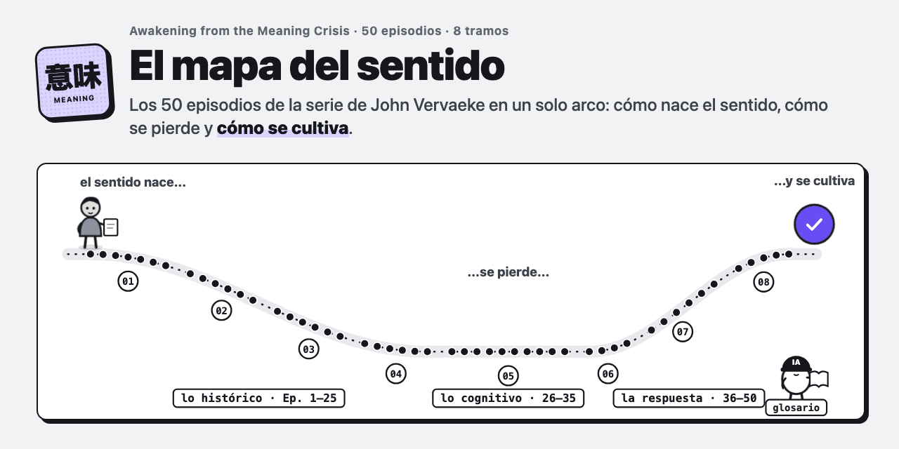
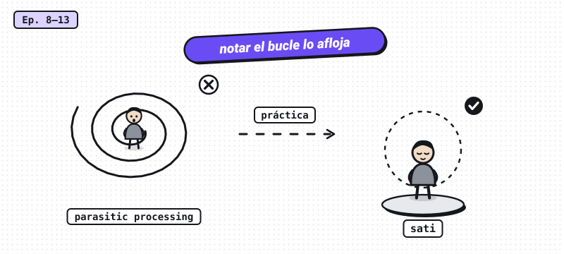

# A map of meaning: *Awakening from the Meaning Crisis*

Study notes on John Vervaeke's 50-episode lecture series, laid out as one arc: how meaning is born, how it gets lost,
and how it can be cultivated again.

**[The map as a page](readme/pagina.html)** (download it and open it in a browser; it works on a phone) ·
[the map as text](mapa.md) · [the glossary](glosario.md) · [a guide for an AI agent](llm.md)

I went through the whole series one episode at a time, with Claude as a study partner. Each episode became a one-page
note: the idea in one sentence, the argument step by step, the new concepts, and questions to think about. Every new
term went into a glossary. At the end I drew the whole arc so it can be seen at a glance. The notes are in Spanish;
this page is in English.

> **In three sentences.** The arc has eight stretches, from shamans and Plato to the cognitive science of relevance
> and to wisdom, and each stretch has an animated drawing that tells its idea. The page opens one stretch at a time:
> tap one and you get what happens in it, its key concepts with their definitions, and its episodes, each with its
> idea in one sentence. The `.md` files are the source, and `node readme/armar.mjs` rebuilds the page from them.

---

## The eight stretches, one drawing each

<table>
<tr>
<td width="50%"> <b>01 · From the shaman to the cave</b>: rising means changing yourself and seeing the world as more real</td>
<td width="50%"> <b>02 · India and the mind</b>: noticing the loop of self-deception loosens it</td>
</tr>
<tr>
<td> <b>03 · Hellenism and Christianity</b>: three orders of meaning that last a thousand years</td>
<td> <b>04 · The modern collapse</b>: the universe goes dead and meaning is left only in the head</td>
</tr>
<tr>
<td> <b>05 · The machinery of meaning</b>: being intelligent is finding what is relevant</td>
<td> <b>06 · Reverse-engineering enlightenment</b>: for each perennial problem, its practice</td>
</tr>
<tr>
<td> <b>07 · Wisdom and rationality</b>: wisdom is seeing through illusion</td>
<td> <b>08 · The prophets</b>: five prophets to be in dialogue with</td>
</tr>
</table>

---

## About the source

The series is John Vervaeke's *Awakening from the Meaning Crisis*, free on his YouTube channel; each note links to its
episode. This repo holds **my own notes and summaries**, in my own words, with timestamps so you can jump to the
original. It holds no transcripts or subtitles, and only a few short phrases are quoted. To hear the argument
properly, watch the lectures. This is an independent study project, not affiliated with or endorsed by Vervaeke.

## What's here

- `mapa.md`: the arc of the whole series on one page (the historical part, the cognitive part, the response).
- `epNN/ficha.md`: one page per episode: the idea in one sentence, the argument step by step, the new concepts,
  questions to think about, and what it connects to.
- `glosario.md`: every Vervaeke term (498 of them) with a plain definition and where he explains it (episode and minute).
- `llm.md`: instructions and a summary so an AI agent can talk philosophy using the glossary and the map.
- `readme/`: the page and the cover of this README.
  - `node readme/armar.mjs` builds `readme/pagina.html` from `mapa.md`, `glosario.md` and the notes.
  - `node readme/dibujar.mjs` draws the eight stretches into `readme/temas/`.
  - `node readme/grabar.mjs` records `readme/portada.gif` (needs Chrome and ffmpeg; set `CHROME` to point at another binary).

All 50 episodes are covered.
